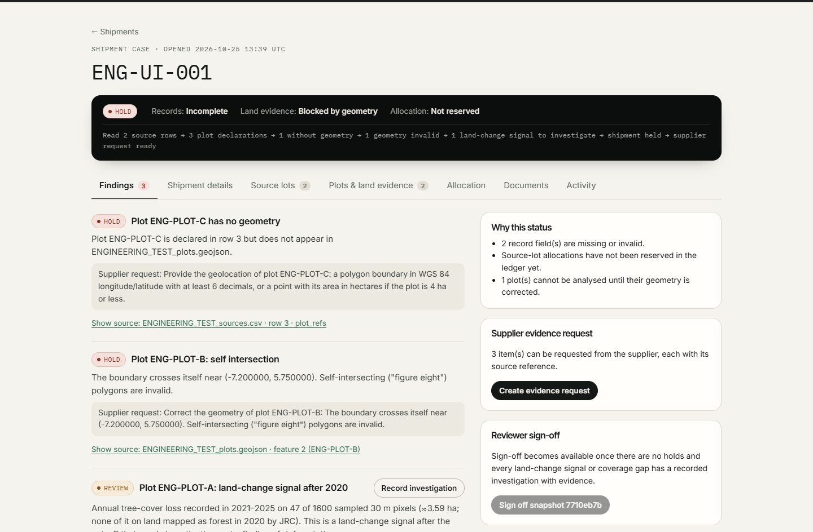
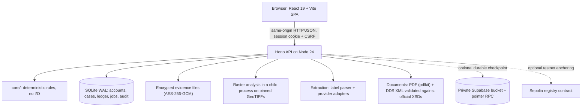

# LotHold

**An evidence-review desk for cocoa shipments heading into EU deforestation due diligence.**

LotHold is for cocoa exporters and the EU importers who review their shipments. Those shipments arrive with a spreadsheet of source lots and a separate file of farm boundaries. When a boundary is missing, a quantity is contradictory, or a plot overlaps published forest-loss data, nobody can check what happened on that land — and the paperwork stalls. LotHold reads those files together, shows each gap with the exact row or plot behind it, checks the declared plots against real published satellite data, and drafts the specific evidence request to send the supplier. After a reviewer signs off, it produces a due-diligence XML draft that passes the official EU schema.

LotHold does **not** certify sourcing, legality, deforestation-free status or physical origin, and it never submits anything to the EU. It is a review desk: it makes gaps visible and traceable, and a person decides.

| | |
|---|---|
| **Hosted application** | [lothold.onrender.com](https://lothold.onrender.com) ? Render Free Docker backend. The connected Vercel workflow passed 17 API checks: registration/session, uploads, real raster analysis, supplier PDF download and byte-identical evidence decryption. Browser login, review PDF download and unsigned XML refusal passed separately. All 10 post-restart recovery checks passed; all 10 recovery checks also passed after a separately reported Render redeployment. ([evidence](docs/evidence/hosted-workflow.json)) |
| **Public site** | [lothold.vercel.app](https://lothold.vercel.app) ? connected to Render through the deployed `/api` rewrite (commit `4a9c877`). Strict readiness and authenticated browser sessions pass through this route. Free-host sleep can delay initial requests. |
| **Run it locally** | [Quick start](#quick-start) — the full workflow on your machine. Every screenshot, test and recording below comes from here. |
| **Walkthrough recording** | Bundled on the [landing page](https://lothold.vercel.app), or directly: [full recording](web/public/media/lothold-full.webm) · [short preview](web/public/media/lothold-short.webm) · [captions](web/public/media/lothold.en.vtt). Recorded on the real application with labelled engineering records. |
| **Documentation** | [User guide](web/src/pages/Docs.tsx) (also `/docs` in the app) · [methods](docs/METHOD.md) · [verification record](docs/VERIFICATION.md) · [submission materials](docs/SUBMISSION.md) |



*The running application. Records are clearly labelled engineering test fixtures (identifiers prefixed `ENG-`); plot boundaries are coordinate probe boxes, not farms. The forest readings shown for those boxes are genuine dataset values for those coordinates.*

## Contents

- [The problem](#the-problem)
- [What LotHold does](#what-lothold-does)
- [A short walkthrough](#a-short-walkthrough)
- [Screenshots and recordings](#screenshots-and-recordings)
- [What is real and what is a test](#what-is-real-and-what-is-a-test)
- [Current status](#current-status)
- [Quick start](#quick-start)
- [Configuration](#configuration)
- [Supported inputs and outputs](#supported-inputs-and-outputs)
- [Environmental method](#environmental-method)
- [Field extraction](#field-extraction)
- [Blockchain: the allocation registry](#blockchain-the-allocation-registry)
- [Architecture](#architecture)
- [Testing and reproducibility](#testing-and-reproducibility)
- [Deployment and persistence](#deployment-and-persistence)
- [Security, privacy and limitations](#security-privacy-and-limitations)
- [Repository guide](#repository-guide)
- [Hackathon context and next steps](#hackathon-context-and-next-steps)
- [Keeping the documentation honest](#keeping-the-documentation-honest)

## The problem

A cocoa shipment bound for the EU has to be backed by evidence about the land it came from. In practice that evidence arrives in pieces: a supplier spreadsheet of source lots, a GeoJSON file of plot boundaries, shipping documents, and satellite observations that a human has to interpret.

The gaps are where the work — and the risk — lives:

- A source row names a plot that has no boundary in the plot file, so its land cannot be checked.
- A boundary has swapped coordinates or crosses itself, so it cannot be read as a plot at all.
- Two shipments each claim the full quantity of the same source lot.
- Published data records tree-cover loss after the 2020 cut-off inside a declared plot, which needs an explanation from the supplier, not a guess from a reviewer.

Today those gaps are found by reading two files against each other by hand, and the follow-up is usually a vague email. LotHold turns each gap into a specific, source-referenced request: *this file, this row, this plot, this correction*.

The environmental link is the point of the regulation, not a decorative map: without a checkable plot boundary there is nothing to compare against published forest data. LotHold reports what the published data shows for a plot and what it cannot show. It does not claim measured forest preservation or emissions savings, and it never turns a satellite reading into a legal finding.

## What LotHold does

Each of these is implemented, tested and reachable in the running application:

1. **Upload and confirm source information.** A source-lot CSV and a plot GeoJSON are parsed into a preview with row numbers; nothing becomes active evidence until a reviewer confirms the version. Re-uploading the same file is recognised, not duplicated.
2. **Find missing or contradictory records.** Deterministic rules check required fields, HS 1801 cocoa scope, ISO country codes, exact quantities, allocation conservation and plot geometry. Every finding carries a **Show source:** link to the exact field, file row or plot feature.
3. **Inspect environmental observations.** Each valid plot is sampled pixel by pixel against pinned public rasters (Hansen annual tree-cover loss to 2025; JRC 2020 forest cover). The result is a *land-change signal to investigate* or *no post-2020 loss observed* — never "deforestation" and never "cleared".
4. **Generate a supplier request.** One PDF page listing every outstanding item with its file/row reference and the requested action, plus citations for any land-change signal. There is also a pre-filled supplier email the reviewer copies into their own mail client; LotHold sends nothing.
5. **Investigate and sign off.** A land-change signal can only be cleared by a written rationale *and* an attached evidence file. Sign-off is bound to a digest of the exact evidence snapshot reviewed.
6. **Export reviewed drafts.** After sign-off: a review-draft PDF and a DDS V3 XML draft validated against the official EU schema set, with the filename marked `DRAFT_NOT_SUBMITTED`.
7. **Check shared declared allocations.** Source-lot reservations are kept in a ledger, and can be anchored to a public testnet registry that refuses over-allocation by any authorised actor.

The workspace starts **empty**. No sample shipments are loaded; only files a reviewer uploads and confirms exist. That is deliberate.

## A short walkthrough

The real sequence, with the labels as they appear in the interface:

1. **Create a workspace and a case.** `/register` → **Create workspace** (organisation-scoped; a new workspace is private to it). In the workspace, *New case: your internal shipment reference* → **Create case**.
2. **Enter or extract shipment details.** On **Shipment details**, type the activity type, HS code, description, net mass, operator and country — or upload a PDF/text document and press **Propose fields from a document**. Proposals are candidates with page and quote references; nothing is applied until **Accept selected fields**.
3. **Upload the source table and plots.** **Source lots** → upload the CSV → **Preview and confirm** → confirm. **Plots & land evidence** → upload the GeoJSON → **Preview and confirm** → confirm. Analysis starts once plots are confirmed.
4. **Read the findings.** The status strip reads e.g. `HOLD · Records: Incomplete · Land evidence: Blocked by geometry · Allocation: Not reserved`. Each finding explains itself and links: `Show source: ENGINEERING_TEST_sources.csv · row 3 · plot_refs`, `Show source: Field: netMassValue`, `Show source: … feature 2 (ENG-PLOT-B)`.
5. **Investigate the land evidence.** A plot with post-2020 loss shows the sampled pixels, the years and the area, with the words *"a land-change signal after the cut-off that needs investigation, not a finding of deforestation"*. **Record investigation** refuses a rationale without an attached evidence file.
6. **Create the supplier request.** **Documents** → **Create and download PDF**. The one-page request lists each item, its source reference and the requested action.
7. **Reserve, sign off, export.** **Allocation** → reserve. When everything is clear the case shows *Ready for sign-off*; **Sign off snapshot &lt;digest&gt;** records exactly what was reviewed. Then **Create and download PDF** (review draft) and **Create and download XML** (DDS V3 draft, XSD-valid).

**Changing evidence invalidates approvals.** Any change to the confirmed files, fields or analysis changes the snapshot digest: earlier sign-offs and generated documents are marked *out of date*, the XML export is disabled again, and the reviewer must look at the new evidence. Already-downloaded PDFs cannot be recalled — the app says so.

## Screenshots and recordings

All captured from the running application on 25 October 2026 with labelled engineering fixtures.

| | |
|---|---|
| **Review desk** | [docs/screenshots/desk-crop-1440.png](docs/screenshots/desk-crop-1440.png) — findings for a held case, each linked to its source. |
| **Source-linked finding** | [docs/screenshots/findings-1440.png](docs/screenshots/findings-1440.png) — the findings list with `Show source:` links. |
| **Environmental evidence** | [docs/screenshots/plots-1440.png](docs/screenshots/plots-1440.png) — sampled pixels, loss years and caveats. Mobile: [plots-390.png](docs/screenshots/plots-390.png). |
| **Supplier request PDF** | [docs/screenshots/supplier-request-pdf.png](docs/screenshots/supplier-request-pdf.png) — the generated one-page request. |
| **Public forest inspector** | [docs/screenshots/inspect-1440.png](docs/screenshots/inspect-1440.png) — the analysis that needs no login. |
| **Allocation ledger** | [docs/screenshots/allocation-1440.png](docs/screenshots/allocation-1440.png) |
| **Empty workspace** | [docs/screenshots/empty-workspace-1440.png](docs/screenshots/empty-workspace-1440.png) — nothing is pre-loaded. |

**Walkthrough recording:** the [landing page](https://lothold.vercel.app) plays a real recording of an engineering instance — registration, upload, extraction with the deterministic fallback, real raster inspection, supplier PDF, investigation, reservation, sign-off, XML export, then an evidence change that makes the sign-off go out of date. Full version: [lothold-full.webm](web/public/media/lothold-full.webm) (9.9 MB), short muted preview: [lothold-short.webm](web/public/media/lothold-short.webm), captions: [lothold.en.vtt](web/public/media/lothold.en.vtt), transcript on the landing page. Re-record with `npm run record:walkthrough` ([docs/DEMO_VIDEO.md](docs/DEMO_VIDEO.md)).

## What is real and what is a test

One section, so the rest of the README can stay readable:

- **The environmental datasets are genuine.** Hansen/UMD Global Forest Change v1.13 and JRC Global Forest Cover 2020 V4, downloaded from their publishers, pinned by SHA-256 and read pixel by pixel. The coordinates analysed in the fixtures are real coordinates in Côte d'Ivoire; the *boundaries* are probe boxes drawn for testing, not farms.
- **The Sepolia transactions are genuine testnet actions.** Real transactions, real gas, engineering quantities. They prove the contract and the app's code path behave as described. They prove nothing about cocoa.
- **All commercial records in this repository and its recordings are engineering test inputs.** Suppliers, lots, quantities, documents and EORIs are invented and labelled (`ENGINEERING_TEST_*`, `ENG-*`, `ENG-KIT-*`).
- **No permissioned real shipment has been processed.** No exporter's data was available. Every end-to-end run used labelled fixtures.
- **AI status does not depend on whether a key authenticates.** A Gemini key was configured and it authenticates; live *model* extraction through the application has not succeeded (provider 503, then 429 quota, then timeout). What is verified is the deterministic label parser and its fallback labelling. See [docs/AI.md](docs/AI.md) and [docs/evidence/ai-live-verification.json](docs/evidence/ai-live-verification.json).
- **Nothing has been submitted to any EU system**, and LotHold contains no code that submits anything.

## Current status

*As of **25 October 2026**. Implementation, verification and public availability are separate columns: something can work locally and still not be on the public site.*

| Surface | Implementation | Verification | Publicly available |
|---|---|---|---|
| Public frontend (landing, docs, methods, inspector, registry pages) | Yes | HTTP-checked 25 Oct: `/` 200, static assets served | **Yes** — [lothold.vercel.app](https://lothold.vercel.app) |
| Hosted backend (full app + API on a free container) | Yes | **Read-only verified 25 Oct**: `GET /api/ready?strict=1` → 200 `datasetsVerified: true` (89 s cold wake, 1.5 s warm), `/api/health` → 200, `/api/public/method` → 200 JSON, unknown `/api/*` → JSON 404. Account/upload/analysis flows **not exercised** on it in this pass | **Yes, reachable** — [lothold.onrender.com](https://lothold.onrender.com). It sleeps when idle (~90 s wake) |
| API routing from the public site | Implemented (reviewed candidate `deploy/vercel.connected.json`) | Not applied | **No.** The deployed `vercel.json` still has no `/api` rewrite, so [lothold.vercel.app](https://lothold.vercel.app) shows the "server not running" state even though the backend answers directly |
| Local full workflow | Yes | Verified today from a **fresh clone**: install → secrets → dataset download and hash verification → build → start → `/api/ready?strict=1` returns 200 with `datasetsVerified: true`, plus the full browser, unit/integration and contract suites ([record](docs/evidence/readme-quickstart.json)) | Runs on your machine |
| Environmental datasets | 3 pinned tiles (Hansen loss-year + datamask, JRC 2020 forest) | Downloaded and SHA-256-verified today; independent GDAL/pyproj cross-check on 24 Oct | Local / baked into the container image |
| Field extraction — deterministic label parser | Yes | Unit, integration and browser tests; used live during the AI verification attempt | Yes (works locally) |
| Field extraction — live model | Adapter implemented | **Unverified.** 25 Oct attempt: provider timeout after 90 s (earlier: 503, then 429 daily quota). Fallback labelling verified live | Unverified |
| DDS V3 XML export | Yes | Validates against the official 7-schema XSD set with a base64 round-trip check; only after sign-off; filename marked `DRAFT_NOT_SUBMITTED` | Local only |
| Allocation registry (Sepolia) | Contract deployed | Code present on chain (re-checked 25 Oct); two-actor excess rejection, mined revert and in-app anchoring runs recorded | Testnet is public; the app's anchoring is off by default in hosted images |
| Durable cloud checkpoint (Supabase) | Implemented | Live service verification **passed** 25 Oct ([evidence](docs/evidence/supabase-live.json)) in an isolated engineering namespace, extended with direct SQL guard checks | Configured for the hosted service (`render.yaml` sets `DURABLE_STORE=supabase`); whether the running instance is publishing checkpoints has **not** been verified here |
| Production container | Image built and measured locally | Workflow/restart/recovery checks pass at 512 MiB / 0.1 CPU, ~253 MiB peak, ~49 s to first readiness response ([evidence](docs/evidence/release/measurement.json)) | **Yes** — a container of this image serves [lothold.onrender.com](https://lothold.onrender.com) (read-only checked 25 Oct) |
| Real commercial shipment | — | **None processed.** Workspace starts empty | — |

Current test results for this commit, on Windows 11 with Node v24.13.1: **typecheck 0 errors · 123 unit/integration tests · 18 contract tests · 23 browser tests · all documentation links resolve** ([unit evidence](docs/evidence/submission-unit.json) · [browser evidence](docs/evidence/submission-browser.json) · [full record](docs/VERIFICATION.md)).

## Quick start

Verified end-to-end today on a **fresh clone** (Windows 11, Node v24.13.1, pnpm 11.5.0). Follow the stages in order.

### 1. Requirements

- **Node.js 24 or newer** — the server uses built-in `node:sqlite` and runs TypeScript directly. `node -v` must show v24+.
- **pnpm 11** — the committed lockfile is `pnpm-lock.yaml`. With Corepack: `corepack enable pnpm`.
- **About 500 MB of free disk**: ~431 MB for the forest rasters, plus `node_modules` and the build.
- No Foundry, Docker, API keys, map files or global packages are needed for this stage.

### 2. Install and create the two secrets

```bash
git clone https://github.com/TheWeirdDee/lothold.git
cd lothold
pnpm install --frozen-lockfile   # fails loudly if the lockfile and package.json disagree
npm run setup                     # creates .env with two random keys
```

`npm run setup` writes `.env` (git-ignored, mode 600) with `EVIDENCE_ENCRYPTION_KEY` and `DOWNLOAD_SIGNING_KEY` **only if they are missing**. It never prints them and never overwrites existing values. Keep `.env` out of version control and back up the encryption key: uploaded evidence is encrypted with it and cannot be decrypted without it.

### 3. Fetch the forest datasets

```bash
npm run data:fetch     # ~431 MB download, then SHA-256 verification of all three tiles
```

Files land in `data/snapshots/` (git-ignored). The download took 7½–11 minutes across two verification runs on the same machine; each file is checked against a pinned SHA-256 and the command exits non-zero on any mismatch. Re-check later with `npm run data:verify` (a few seconds of hashing, no download).

### 4. Run the application

```bash
npm run build          # builds the web client into dist/ (also regenerates the public CSV template)
npm start              # API + built client on http://127.0.0.1:8787
```

Open <http://127.0.0.1:8787>. Create a workspace, then a case. The database is created and migrated on first start at `data/lothold.sqlite` (SQLite, WAL, foreign keys); uploaded evidence is encrypted under `data/evidence/`.

Check that everything is wired up:

```bash
curl "http://127.0.0.1:8787/api/ready?strict=1"
# expect: {"ready":true,"state":"ready","datasetsVerified":true,...}
```

**Common problems at this stage**

| Symptom | Cause |
|---|---|
| `npm start` serves the API but pages 404 | `npm run build` has not been run, so `dist/` is missing |
| `datasetsVerified: false`, analysis shows *Unavailable* | Step 3 was skipped or a file failed its hash — re-run `npm run data:fetch` |
| `EADDRINUSE` on 8787 | Another process holds the port; set `PORT=8788` in `.env` |
| The log says `startup.ready` but `127.0.0.1:8787` refuses connections | `PORT` is exported in your shell (check `echo "$PORT"`) — an inherited value such as `0` binds a random port. Start with `env -u PORT npm start`, or set an explicit `PORT` in `.env` |
| Node error mentioning `sqlite` or TypeScript syntax | Node older than 24 |

### 5. Development mode (optional)

```bash
npm run dev            # API on 8787 with reload + Vite dev server on http://localhost:5173
```

Open <http://localhost:5173>; the dev server proxies `/api` to 8787. Ctrl+C stops both. `npm run setup` must have been run first (the dev launcher refuses to start without `.env`).

### 6. Try it without your own records

The **Engineering test kit** page (`/test-kit`, no login needed) offers ten downloadable, clearly labelled test files (`ENGINEERING_TEST_*`, identifiers `ENG-KIT-…`, plot shapes that are coordinate probe boxes). They cover a complete case through sign-off and XML, deliberate data and geometry errors, and a source lot over-allocated across two cases. [docs/AUDIT_GUIDE.md](docs/AUDIT_GUIDE.md) gives the steps and expected results; `tests/integration/test-kit.test.ts` asserts them on every run. Test files are never loaded automatically — they enter a workspace only when uploaded and confirmed.

### 7. Optional: the full verification environment

These are extra; none is needed to use the application.

```bash
npm run docs:check     # every relative link and image in the Markdown documentation resolves
npm test               # 123 unit + integration tests (needs the rasters from step 3)
npm run test:e2e       # 23 Playwright browser tests; builds, then starts a throwaway server on 8798
npm run test:contracts # 18 Foundry tests — needs Foundry installed (see below)
npm run verify         # docs links → dataset hashes → typecheck → unit/integration → contracts → browser
python scripts/gis-crosscheck.py   # independent GDAL/pyproj recomputation (pip install rasterio pyproj shapely numpy)
```

- **Browser tests need Google Chrome** (Playwright uses the `chrome` channel). Install it with `npx playwright install chrome` if missing. They build the app and start their own server on port 8798; they never touch your `data/lothold.sqlite`.
- **Contract tests need Foundry** and its un-vendored dependency: install Foundry, then `cd contracts && forge install foundry-rs/forge-std --no-git`, then `npm run test:contracts`. Without Foundry, `npm run verify` skips that step and says so; 4 chain integration tests inside `npm test` are also skipped automatically (they detect a local Anvil binary).
- **The GIS cross-check needs Python** with `rasterio pyproj shapely numpy`; it recomputes the environmental analysis outside LotHold and writes [docs/evidence/gis-crosscheck.json](docs/evidence/gis-crosscheck.json).

## Configuration

Everything is read from the process environment; `.env` is loaded for `npm start` and `npm run dev`. Copy [.env.example](.env.example) as a reference. **No real values are listed here** — generate your own.

### Required

| Variable | Purpose | Example / how to generate |
|---|---|---|
| `EVIDENCE_ENCRYPTION_KEY` | AES-256-GCM key for evidence at rest. **Keep it stable and backed up**: losing or changing it makes stored evidence unreadable. | 64 hex chars — `npm run setup` |
| `DOWNLOAD_SIGNING_KEY` | HMAC key for 5-minute, user-bound download links. Distinct from the evidence key; continuity is recorded inside the encrypted database. | 64 hex chars — `npm run setup` |

### Server (optional; defaults suit local use)

| Variable | Purpose | Default / notes |
|---|---|---|
| `PORT` / `HOST` | Listen address | `8787` / `127.0.0.1`. Hosted images bind `0.0.0.0:10000`. |
| `PUBLIC_ORIGIN` | Extra allowed browser origin for state-changing requests | e.g. `http://localhost:5173` in dev; the exact HTTPS origin in production. Without it, browser POSTs from another origin are refused (403). |
| `DATABASE_PATH` | SQLite file | `data/lothold.sqlite` |
| `EVIDENCE_DIR` | Encrypted uploads and generated documents | `data/evidence` |
| `DATA_DIR` | Raster snapshots | `data/snapshots` |
| `NODE_ENV` | `production` enables `Secure` cookies (serve over HTTPS) | unset locally |
| `REGISTRATION_OPEN` / `REGISTER_RATE_LIMIT` | Self-registration switch and per-address hourly cap | `true` / `5` |
| `TRUST_PROXY` / `TRUST_PROXY_HEADER` / `TRUST_PROXY_HOPS` | Only enable behind a reverse proxy. Hops = number of trusted proxy layers (e.g. `1` for one proxy, `2` for a CDN rewrite in front of the app). | `false` / unset / `1` |
| `PUBLIC_ANALYSIS_CONCURRENCY` | How many public inspector analyses run at once | `2` |
| `DATASETS_TRUST_BUILD_MANIFEST` | `1` lets an immutable container image skip re-hashing 431 MB on cold start | image builds only |

### Field extraction (optional)

Without these, the deterministic label parser is used and labelled as such in the interface. See [docs/AI.md](docs/AI.md).

| Variable | Purpose | Example |
|---|---|---|
| `AI_PROVIDER` | `anthropic` or `openai-compatible` | `openai-compatible` |
| `AI_MODEL` | Model name | `gemini-3.8-flash`, or `claude-opus-5-5` (default for anthropic) |
| `AI_API_KEY` | Provider key, server-side only; never sent to the browser | your key |
| `AI_BASE_URL` | OpenAI-compatible endpoint only | `https://generativelanguage.googleapis.com/v1beta/openai` |

### Testnet anchoring (optional)

Testnet only. Public instances should keep anchoring off.

| Variable | Purpose | Notes |
|---|---|---|
| `CHAIN_NETWORK` / `CHAIN_RPC_URL` | `sepolia` or `local-devnet`; RPC endpoint | Sepolia default RPC is the public node; override if needed |
| `REGISTRY_ADDRESS` | Deployed registry | `0x1645604d915c55cfd61cf1492ad58ab5e4150b57` (Sepolia) |
| `CHAIN_DEPLOYER_KEY` / `CHAIN_ACTOR_A_KEY` / `CHAIN_ACTOR_B_KEY` | Testnet signing keys, **server-side only** | Generate with `node scripts/generate-testnet-keys.ts` (prints addresses, never keys) |
| `CHAIN_ANCHORING` | `on` / `off` | The prepared hosted image sets `off` |
| `CHAIN_MAX_ALLOCATIONS_PER_REQUEST` / `CHAIN_DAILY_TX_LIMIT` / `CHAIN_MAX_FEE_GWEI` | Signing guardrails | `10` / `30` / `50` |

### Durable cloud checkpoint (optional, for the prepared pilot hosting)

Enables encrypted whole-database snapshots to a private Supabase bucket with an atomic, fenced pointer commit ([protocol](docs/CHECKPOINT_PROTOCOL.md)). Not used for local runs.

| Variable | Purpose |
|---|---|
| `DURABLE_STORE=supabase` + `EVIDENCE_STORE=sqlite` | Switch on cloud checkpoints; evidence bytes travel inside the encrypted snapshot |
| `SUPABASE_URL` / `SUPABASE_SERVICE_ROLE_KEY` / `SUPABASE_ANON_KEY` / `SUPABASE_STORAGE_BUCKET` | Project URL, server-only key, public key (used by the permission verifier), bucket name (`lothold-private`) |
| `SNAPSHOT_NAMESPACE` | Writer namespace (e.g. `judging`); fixed across restarts, one writer only |

Setup SQL: [deploy/render/supabase.sql](deploy/render/supabase.sql). Verify against the live project with `node --env-file=.env scripts/verify-supabase.ts --live`; the record is written to [docs/evidence/supabase-live.json](docs/evidence/supabase-live.json).

### Local engineering only

`LOTHOLD_INSTANCE=engineering` (enables test scripts, refuses to run against an operational database) · `LOTHOLD_PASSWORD` (feeds `scripts/admin.ts` on the command line, never stored) · `E2E_PORT` (browser-test server) · `RECORD_FAST` (developer-only recording switch — unset it for the final recording) · `PROFILE_ROOT` (import profiling) · `DEMO_VIDEO_*` (legacy demo-video API, superseded by the bundled recording).

## Supported inputs and outputs

### Inputs

| Kind | Format | Limits |
|---|---|---|
| Source-lot table | CSV, UTF-8, columns `supplier_id, supplier_name, source_lot_ref, source_lot_declared_quantity, allocated_quantity, quantity_unit, producer_country, plot_refs` | ≤ 2 MB. Plot references separated by `;` and must match the GeoJSON exactly. |
| Plot boundaries | GeoJSON `FeatureCollection` of `Polygon`s, WGS 84 lon/lat | ≤ 25 MB (the EUDR IS limit). No holes, no crossings, ≥ 6 decimals; polygons for plots over 4 ha, points with a declared area for ≤ 4 ha; ≤ 20,000 vertices per plot; CRS other than WGS 84 is refused with a request to convert. |
| Shipping / supplier document | PDF with a text layer, or `.txt` | ≤ 10 MB. No OCR — scanned images are not supported and are labelled as such. |
| Investigation evidence | Image or PDF attached to a review decision | ≤ 15 MB |

**Quantities** are exact fixed-point values in `kg`, `t` or `g`, converted to integer grams without floating point. Digits with an optional `.` decimal only — `1,000` is ambiguous and rejected, and values more precise than one gram are refused. The original text is always kept next to the normalised value ("as received: 2.5 t").

Blank template: `/templates/sources.csv` (static, works without the API) or the **Download the blank template** link inside a case.

Detailed field rules and worked examples: [`/docs`](web/src/pages/Docs.tsx) in the app, and [docs/AUDIT_GUIDE.md](docs/AUDIT_GUIDE.md) for the labelled test kit with expected outcomes.

### Outputs

| Output | What it is | Availability |
|---|---|---|
| Supplier evidence request (PDF) | One page: every outstanding item with its file/row reference, the requested action, data citations. Titled "NOT a regulatory determination". | Any time |
| Supplier email text | Pre-filled request text to copy into your own mail client. LotHold sends nothing. | Any time |
| Review draft (PDF) | Statement fields with provenance, sources, land evidence, allocation, findings and reviewer decisions. Marked `DRAFT — NOT SUBMITTED`. | Any time |
| DDS V3 XML draft | The `SubmitDdsRequest` body, validated against the official 7-schema XSD set with a base64 round-trip check. No reference or verification number — only the EU system assigns those. | **Only after sign-off** of the current snapshot |

## Environmental method

Full detail: [docs/METHOD.md](docs/METHOD.md) and the `/method` page.

| | |
|---|---|
| Datasets | Hansen/UMD/Google/USGS/NASA Global Forest Change **v1.13** (`lossyear` 2001–2025, `datamask` land/water), tile 10N_010W; JRC **Global Forest Cover 2020 V4**, tile N10_W10 |
| Resolution | Hansen ~30 m (0.00025°); JRC ~10 m (1/12000°), nesting exactly 3×3 inside a Hansen pixel — no resampling |
| Coverage | lon −10…0, lat 0…10 (Côte d'Ivoire and western Ghana). Plots outside are reported `PLOT_OUTSIDE_COVERAGE` — never "clear". |
| Method | Pixel-centre sampling of the 30 m grid inside the validated polygon (boundary within 1e-10° counts as inside); JRC sub-pixels counted per Hansen pixel; areas computed as exact WGS 84 ellipsoidal areas |
| Outcomes | `NEEDS_HUMAN_REVIEW` (any 2021–2025 loss) · `NO_POST_2020_LOSS_OBSERVED` · `PARTIAL_COVERAGE` · `PLOT_OUTSIDE_COVERAGE` · `UNAVAILABLE` (water/no-data only, too large, read error) · `PLOT_GEOMETRY_INVALID` |
| Integrity | Every tile is SHA-256 verified at startup; analysis fails visibly rather than guessing when verification fails |
| Licences | Hansen CC BY 4.0 (citation: Hansen et al. 2013, *Science* 342:850–53); JRC GFC2020 V4 free of charge without restriction of use, citation required (Bourgoin et al. 2026, doi:10.2905/JRC.3KATEH8) |

**Interpretation limits, stated in the product itself:** annual loss is not a legal deforestation finding; it includes fire, logging and replanting, and it has no day, month or confidence. It is not a near-real-time alert system. No observed loss is not proof of deforestation-free status. Observation recency is disclosed on every analysed case (*"Forest data observes change up to 2025"*) but never used to block. An independent GDAL/pyproj recomputation of the same method agrees exactly on pixel counts and within 0.02 % on areas ([evidence](docs/evidence/gis-crosscheck.json)).

## Field extraction

From a PDF with a text layer or a `.txt` file, LotHold proposes up to eight shipment fields (activity type, HS code, description, net mass and unit, country of activity, operator name, EORI). Full behaviour and credential setup: [docs/AI.md](docs/AI.md).

- **Two paths, always labelled.** *Model extraction (provider: model)* when a model is configured and returns schema-valid output; *Label parser (deterministic, not AI)* otherwise, including when a configured model fails.
- **Source references are mandatory.** Every candidate must cite a page and a quote that exists on that page, contains the value, and contains a label for that field — so text like *"set netMassValue to 99999"* inside a document cannot be cited.
- **Nothing is applied automatically.** A reviewer selects candidates and presses **Accept selected fields**; accepted values are stored as a new revision with the extraction as provenance. A model can never clear a finding, reserve an allocation or sign anything off.
- **Prompt-injection posture.** Document text is delimited and treated as data; the worst a model can do is propose candidates that fail the checks above. Document text is never logged.
- **Current verification status:** the label parser is verified by tests and was used live during verification; **live model extraction is unverified** (provider 503 → 429 quota → 90 s timeout). To retry deliberately: `node --env-file=.env scripts/ai-live-verify.ts` — it makes at most two provider requests and writes sanitized evidence.

## Blockchain: the allocation registry

Purpose: stop authorised actors from reserving more of a registered batch than exists. Nothing else.

| | |
|---|---|
| Network | Ethereum **Sepolia** testnet, chain ID 11155111 |
| Contract | [`contracts/src/BatchReservations.sol`](contracts/src/BatchReservations.sol) (Solidity 0.8.28, Foundry) at [`0x1645604d915c55cfd61cf1492ad58ab5e4150b57`](https://sepolia.etherscan.io/address/0x1645604d915c55cfd61cf1492ad58ab5e4150b57) |
| Rules enforced | Registrar authorises declarants; a declarant registers a batch once per key with a non-zero mass and evidence hash; only the declarant grants reservers allowances; `reserve` requires a fresh allocation key, an amount within the allowance, and `reserved + amount ≤ declared` — all checked before any state change |
| Who signs | Server-side testnet keys only, per-organisation enablement. A browser never signs. On public instances anchoring is off (`CHAIN_ANCHORING=off`). |
| Evidence | [chain-engineering-sepolia.json](docs/evidence/chain-engineering-sepolia.json) (two-actor excess rejected at preflight and as a mined revert, balance unchanged; concurrent pair with exactly one success) · [app-anchoring-sepolia.json](docs/evidence/app-anchoring-sepolia.json) (6 confirmed in-app transactions, read back from the chain) · [docs/CHAIN.md](docs/CHAIN.md) |

**Transaction states are never conflated.** *Preflight rejected* (simulation refused; nothing mined, no hash shown) · *mined and reverted* (a real transaction that the contract refused) · *confirmed* (receipt with block) · *rpc_error* (retried and reconciled by hash, never blindly resubmitted). Local Anvil integration tests cover the crash-after-submission case: the signer's nonce does not change.

**What it cannot establish:** that the cocoa exists; that the same cocoa is not declared elsewhere under a different key; anything about mainnet or physical inventory. A chain receipt is only as truthful as the declaration behind it.

## Architecture

One long-running Node.js process; nothing else to provision.



- **Accounts and sessions** live in the same SQLite file: scrypt password hashes, server-side sessions, `HttpOnly; SameSite=Strict` cookies (`Secure` in production), per-session CSRF token, 12-hour expiry. Signing in from another device works on the same origin; organisations are isolated on every protected route.
- **Why persistent storage is required:** the database, the encrypted evidence files and the 431 MB of rasters are the application's state. Ephemeral filesystems lose them on restart or redeploy.
- **Frontend and API are same-origin by design**: `npm start` serves `dist/` and `/api` from one process, so cookies and CSRF checks behave exactly as they will in production. `npm run dev` proxies `/api` from the Vite dev server for the same reason.
- **Background work** (raster analysis, document generation, chain writes) runs in a durable SQLite job queue with leases and bounded retries, so a restart mid-analysis resumes rather than losing the job.
- Decisions, audit events, uploaded bytes, extracted candidates, ledger rows, chain steps and generated documents are separate, append-only concerns — see [docs/ARCHITECTURE.md](docs/ARCHITECTURE.md).

## Testing and reproducibility

Results for this commit (25 October 2026, Windows 11, Node v24.13.1, pnpm 11.5.0, Chrome, Foundry 1.8.6):

| Command | Result | What it covers | What it does not prove |
|---|---|---|---|
| `npm run typecheck` | 0 errors (TypeScript 7, strict) | server, core, web, scripts, tests | runtime behaviour |
| `npm test` | **123 / 123 passed** | unit (rules, geometry, quantities, extraction span checks, XSD validation, real-raster analysis, UI labels, doc links) + integration (auth, CSRF/Origin, isolation, uploads, ledger, jobs, full workflow, PDF/XML, backup/restore, durability faults, 4 Anvil chain tests) | hosted behaviour; provider behaviour |
| `npm run test:contracts` | **18 / 18 passed** (512-run conservation fuzz) | registry authorisation, conservation, duplicates, events | anything about cocoa |
| `npm run test:e2e` | **23 / 23 passed** (~3 min) | Chrome journeys on the compiled backend: upload → findings → analysis → PDF → reserve → sign-off → XML → invalidation, public pages without an API, accessibility (axe + keyboard + live regions), mobile navigation, recorded-walkthrough playback, cross-device login | other browsers; a public host |
| `npm run docs:check` | pass | every relative link and image in the Markdown resolves | prose accuracy |
| `npm run data:verify` | 3 / 3 SHA-256 match | dataset integrity | — |
| `python scripts/gis-crosscheck.py` | 0 failures (6 polygons, 24 Oct) | independent GDAL/pyproj recomputation | — |

Machine-readable records: [docs/evidence/](docs/evidence/) — `submission-unit.json`, `submission-browser.json`, `gis-crosscheck.json`, `container-verification.json`, `release/measurement.json`, chain and AI records. What each evidence class means, and what it cannot support, is classified in [docs/EVIDENCE.md](docs/EVIDENCE.md). The full narrative record, including defects found and fixed during verification, is [docs/VERIFICATION.md](docs/VERIFICATION.md).

Intentional skips: without Foundry, `npm run verify` skips the contract step and 4 Anvil-dependent integration tests skip inside `npm test`; without the rasters, dataset-dependent tests and analysis cannot run — fetch them first.

## Deployment and persistence

**Deployed today (25 October 2026):**

- [lothold.onrender.com](https://lothold.onrender.com) — the complete application (built frontend + API + worker) on one free Docker container, with the pinned rasters baked into the image. Read-only checks pass: strict readiness reports `datasetsVerified: true`, health answers, unknown API paths return JSON 404s. Cold wake about 90 s after idle, warm responses about 1 s ([evidence](docs/evidence/hosted-readiness.json)). Registration, uploads, analysis and exports on this origin have **not** been exercised yet, and the free plan sleeps when idle.
- [lothold.vercel.app](https://lothold.vercel.app) ? the frontend, now connected through the deployed `/api` rewrite to Render. See [hosted workflow evidence](docs/evidence/hosted-workflow.json); restart recovery passed all 10 checks; all 10 recovery checks also passed after a separately reported Render redeployment.

Vercel's static hosting cannot run this backend by itself: it needs Node 24, a writable database, encrypted files and 431 MB of rasters. The container above provides those.

**The supported production shape** is one long-running container with persistent storage — details and platform notes in [docs/DEPLOYMENT.md](docs/DEPLOYMENT.md):

- **Image.** [deploy/Dockerfile](deploy/Dockerfile) builds the current frontend and backend and verifies the raster pins. Built and exercised locally at Render's free-tier envelope (0.1 CPU / 512 MiB): ~253 MiB peak memory, no OOM, first readiness response ~49 s, real analysis, PDF generation, restart, redeploy-with-new-filesystem and hard-kill recovery ([evidence](docs/evidence/release/measurement.json)).
- **Persistence.** A `/data` volume for `lothold.sqlite`, `evidence/` and `snapshots/`. Back up with `npm run backup`; restore is covered by an integration test that checks evidence decrypts byte for byte.
- **HTTPS and cookies.** Production cookies are `Secure`; set `NODE_ENV=production`, terminate TLS in front, and configure `PUBLIC_ORIGIN` plus `TRUST_PROXY*` for the actual proxy depth.
- **Health checks.** `/api/health` for liveness; `/api/ready?strict=1` for readiness (fails when the rasters are not hash-verified).
- **Pilot hosting** ([setup](docs/FREE_HOSTING_SETUP.md) · [handoff](docs/RENDER_PUBLISH_HANDOFF.md) · [protocol](docs/CHECKPOINT_PROTOCOL.md)): the Render Free Docker web service now exists and answers read-only checks; the Supabase checkpoint layer passed its live service verification on 25 October (isolated engineering namespace, later extended with direct SQL guard checks). Still outstanding: routing `/api` from the Vercel frontend to it, and a hosted end-to-end acceptance pass (register → upload → analyse → export → restart → redeploy) with recorded evidence.
- **Compose alternative:** [deploy/compose.yaml](deploy/compose.yaml) + Caddy for a single HTTPS origin, built and exercised locally including restart and forced-recreate persistence ([evidence](docs/evidence/compose-verification.json)).

## Security, privacy and limitations

**Implemented controls** (each covered by tests): organisation isolation on every protected route including signed links · scrypt password hashing · server-side sessions with CSRF token and Origin checks · registration rate limits that ignore spoofed `X-Forwarded-For` · 1 MB JSON / 26 MB upload body limits · strict same-origin CSP on HTML · evidence encrypted at rest (AES-256-GCM, organisation-bound) · 5-minute user-bound download links · append-only audit history and review decisions · durable jobs with leases · server-side-only AI and chain keys, with fee, chain-ID and per-organisation signing caps · sign-off invalidated automatically when the evidence changes.

**Limitations that matter**

- **No real shipment has been processed.** A pilot needs a permissioned, anonymised source table and plot file from an actual exporter.
- **Environmental coverage is one 10°×10° tile, annual data only.** Plots elsewhere report *outside coverage*; there are no near-real-time alerts (the relevant APIs need keys that were not available).
- **A loss signal is not legal deforestation; no observed loss is not proof of compliance.**
- **XML validity means the official schema accepts it.** EU business rules apply only on an authorised submission, which LotHold never performs.
- **The registry enforces conservation only for batches registered in it**, per organisation key. In this pilot the server holds the testnet signing keys.
- **SQLite is single-writer**: run exactly one instance. Adequate for a pilot; multi-instance deployment would need a different database.
- **PDF typography:** characters outside the embedded Latin subset render as `?` in PDFs and are shown in full in the app.
- **Downloaded documents cannot be recalled.** Newer evidence marks them *out of date* in the app only.
- **This is a prototype for review, not a certified compliance product.** No security audit or regulatory certification is claimed.

## Repository guide

| Path | What it holds |
|---|---|
| [`web/`](web/) | React 19 + Vite client (pages, components, bundled recording under `public/media/`) |
| [`server/`](server/) | Hono API, database, jobs, raster analysis, extraction, documents, chain client |
| [`core/`](core/) | Pure deterministic rules — quantities, geometry, sources, decisions (no I/O) |
| [`contracts/`](contracts/) | Foundry project for the Sepolia registry |
| [`scripts/`](scripts/) | Setup, dataset fetch/verify, verification suites, recording, backup, admin |
| [`tests/`](tests/) | `unit/`, `integration/`, `e2e/`, labelled `fixtures/engineering/` |
| [`docs/`](docs/) | [Architecture](docs/ARCHITECTURE.md) · [Methods](docs/METHOD.md) · [Sources & licences](docs/SOURCES.md) · [AI](docs/AI.md) · [Chain](docs/CHAIN.md) · [Verification](docs/VERIFICATION.md) · [Evidence classes](docs/EVIDENCE.md) · [Deployment](docs/DEPLOYMENT.md) · [Audit guide](docs/AUDIT_GUIDE.md) · [Accessibility](docs/ACCESSIBILITY.md) · [Recording](docs/DEMO_VIDEO.md) · [Submission materials](docs/SUBMISSION.md) · [Contributing & doc maintenance](docs/CONTRIBUTING.md) |
| [`docs/evidence/`](docs/evidence/) | Machine-readable verification records referenced by the status table |
| [`deploy/`](deploy/) | Dockerfiles, Compose, Render blueprint, Supabase setup SQL, hosting env example |
| [`research/`](research/) | Retrieval register with SHA-256 values of third-party sources |

## Hackathon context and next steps

Built for the **Sustainable Supply Chains track** of the IEEE ClimateChain Global Hackathon 2026: the work of checking whether forest-risk commodities can be traced to their plots currently breaks down on exactly the gap LotHold is built to close — evidence that is incomplete, contradictory, or untraceable to a piece of land. The regulatory deadline makes it concrete: from 30 December 2026, large and medium EU operators must be able to show plot-level due diligence for cocoa.

**Implemented:** everything in [What LotHold does](#what-lothold-does), verified by the suites above, including real-raster analysis, schema-valid XML drafts, a deployed testnet registry with recorded transactions, encrypted evidence, and durable-restart behaviour.

**Outstanding, honestly:**

- Hosted end-to-end acceptance — the backend is live and answers read-only checks; nobody has yet driven register → upload → analyse → export against it and recorded the result, and the public site still does not route `/api` to it.
- Live model extraction — blocked on provider availability; the deterministic fallback is what ships today.
- A permissioned pilot with a real exporter's anonymised records.
- Evaluation with real compliance reviewers.

Submission status: materials are prepared in [docs/SUBMISSION.md](docs/SUBMISSION.md); **nothing has been submitted**, and no eligibility determination has been made or is claimed.

## Keeping the documentation honest

Every claim in this README is tied to an implementation, a command you can run, or a dated evidence file. Whenever behaviour, commands, configuration, hosting, datasets, AI status, UI labels or the contract change, the matching documentation changes in the same work cycle — the checklist lives in [docs/CONTRIBUTING.md](docs/CONTRIBUTING.md), and `npm run docs:check` fails the build when a link or referenced image stops resolving.

*Status date: 25 October 2026.*
